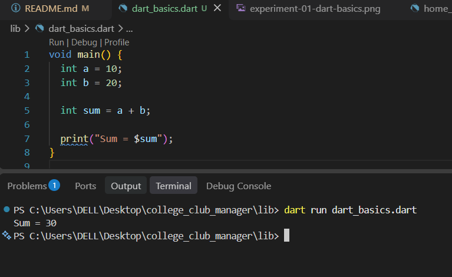
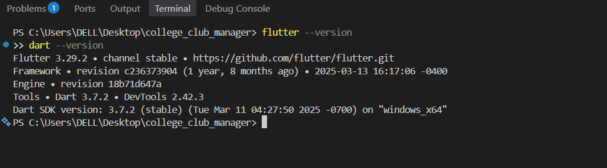
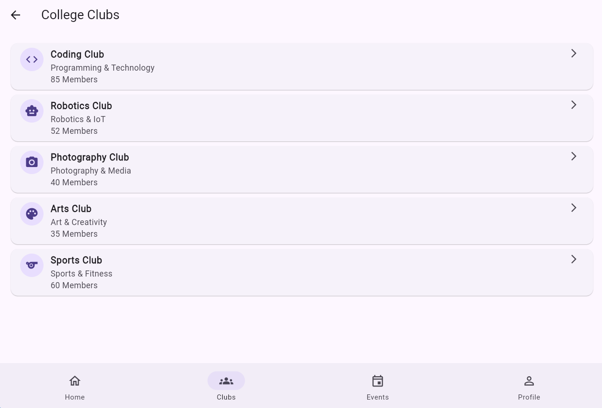
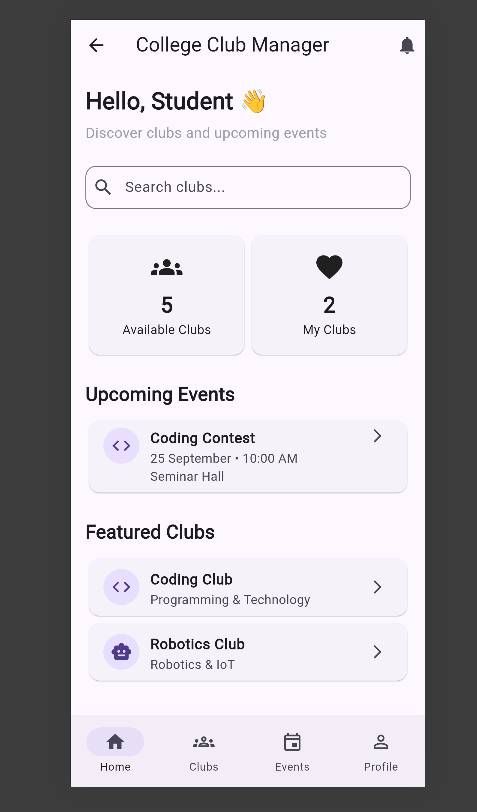
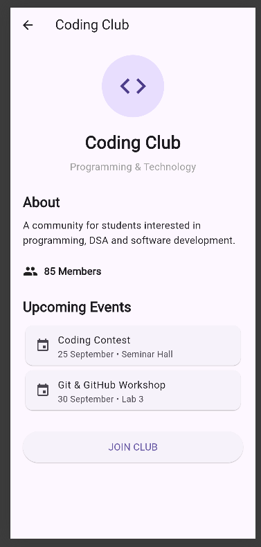
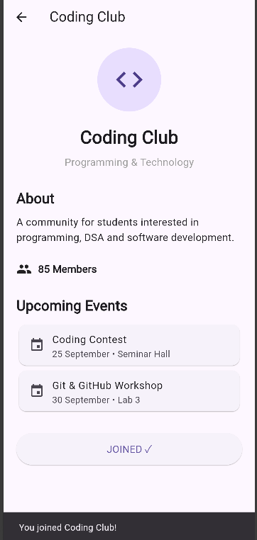
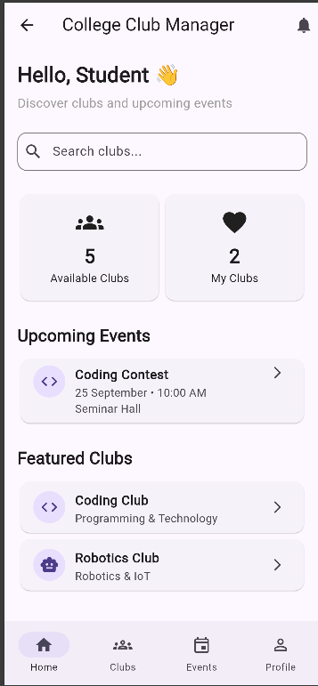

## Experiment 1: Installation of Flutter & Dart SDK and Introduction to Dart Programming

### Aim

To install and verify the Flutter and Dart SDKs and understand the basics of Dart programming.

### Description

Flutter is a framework used to develop cross-platform applications, while Dart is the programming language used by Flutter. This experiment introduces basic Dart variables, data types, and output statements.

### Code Glimpse

```dart
void main() {
  String club = 'Coding Club';
  int members = 50;

  print('$club has $members members');
}
```

### Output

```text
Coding Club has 50 members
```

### SDK Verification

Run the following commands in the terminal to check the installed versions:

```bash
flutter --version
dart --version
```

### Output Screenshots



_The Dart program declares two integer variables, adds them, and prints the
verified result `Sum = 30` in the terminal._



_The terminal verifies Flutter `3.29.2` and Dart `3.7.2` using
`flutter --version` and `dart --version`._

### Result

The basic Dart program demonstrates variable declaration and output generation. Flutter and Dart SDK installation can be verified using the above commands.

## Experiment 2: Exploring Flutter Widgets and Layout Structures

### Aim

To explore basic Flutter widgets and implement layouts using `Row`, `Column`, and `Stack`.

### Code Glimpse

```dart
Column(
  children: [
    Text('College Club Manager'),
    Row(
      children: [
        Icon(Icons.groups),
        Text('Coding Club'),
      ],
    ),
  ],
)
```

### Output

A layout displaying the application title and a row containing a club icon and its name.

### Screenshot

The Clubs screen demonstrates a scrollable `ListView` layout composed of
`Card`, `ListTile`, `CircleAvatar`, `Icon`, and `Text` widgets. The bottom
`NavigationBar` provides access to the application's main sections.



_The College Clubs screen displays club names, categories, member counts,
icons, cards, and bottom navigation using widgets implemented in
`lib/screens/clubs_screen.dart` and `lib/screens/main_screen.dart`._

### Result

Basic Flutter widgets and layout structures were explored.

## Experiment 3: Responsive UI Using MediaQuery and LayoutBuilder

### Aim

To design a responsive user interface that adapts to different screen sizes using `MediaQuery` and `LayoutBuilder`.

### Implementation Evidence

The current Home screen uses `SingleChildScrollView` to allow vertical
scrolling and `Expanded` widgets to share the available width between its
summary cards. Repository inspection found no `MediaQuery`, `LayoutBuilder`,
or explicit responsive breakpoints, so adaptation across different screen
sizes is not yet verified.

### Code Glimpse from `lib/screens/home_screen.dart`

```dart
SingleChildScrollView(
  padding: const EdgeInsets.all(16),
  child: Column(
    crossAxisAlignment: CrossAxisAlignment.start,
    children: [
      Row(
        children: [
          Expanded(child: Card(/* Available Clubs */)),
          Expanded(child: Card(/* My Clubs */)),
        ],
      ),
    ],
  ),
)
```

### Output

The screenshot records the Home screen on one mobile-sized viewport. It shows
the two summary cards sharing the available row width and the remaining
content arranged in a vertically scrollable layout.

### Screenshot



_The College Club Manager Home screen displayed on a mobile-sized viewport.
This image verifies the current mobile layout only; it does not prove
breakpoint-based responsive behavior._

### Result

**Status: Partially demonstrated.** Flexible width sharing and vertical
scrolling are present, but `MediaQuery`, `LayoutBuilder`, and responsive
breakpoints are not implemented or verified in the current source.

## Experiment 4: Navigation Using Navigator and Named Routes

### Aim

To navigate between Flutter screens using `Navigator` and named routes.

### Implementation Evidence

The application uses `Navigator.push` with `MaterialPageRoute` for navigation
from Login to the main screen, from Clubs to Club Details, and from Events to
Event Details. `Navigator.pop` is also used to return from the Profile screen.
Named routes (`routes`, `pushNamed`, or `onGenerateRoute`) are not implemented.

### Code Glimpse from `lib/screens/clubs_screen.dart`

```dart
Navigator.push(
  context,
  MaterialPageRoute(
    builder: (context) => const ClubDetailsScreen(
      clubName: 'Coding Club',
      category: 'Programming & Technology',
      description:
          'A community for students interested in programming, DSA and software development.',
      members: 85,
      icon: Icons.code,
    ),
  ),
);
```

### Output

Selecting the Coding Club card opens its Club Details screen. Flutter's
automatically provided back button returns to the previous screen.

### Screenshot



_The Coding Club details page reached through `Navigator.push` and
`MaterialPageRoute` from the Clubs screen._

### Result

**Status: Partially demonstrated.** Navigator-based screen navigation is
implemented and verified, but named-route navigation is not implemented.

## Experiment 5: Stateful and Stateless Widgets with State Management

### Aim

To understand `StatelessWidget`, `StatefulWidget`, and state updates using `setState()` and Provider.

### Implementation Evidence

`ClubDetailsScreen`, `EventDetailsScreen`, and `MainScreen` are implemented as
`StatefulWidget` classes. Screens such as `HomeScreen`, `ClubsScreen`, and
`ProfileScreen` are implemented as `StatelessWidget` classes. On the Club
Details screen, `setState` toggles the local `isJoined` value, changes the
button label, and triggers a confirmation `SnackBar`. Provider is not listed
as a dependency and no Provider-based state management was found.

### Code Glimpse from `lib/screens/club_details_screen.dart`

```dart
bool isJoined = false;

onPressed: () {
  setState(() {
    isJoined = !isJoined;
  });

  ScaffoldMessenger.of(context).showSnackBar(
    SnackBar(
      content: Text(
        isJoined
            ? 'You joined ${widget.clubName}!'
            : 'You left ${widget.clubName}.',
      ),
    ),
  );
},
```

### Output

After the Join Club button is selected, the UI updates the button text to
`JOINED ✓` and displays the message `You joined Coding Club!`.

### Screenshot



_The Coding Club details screen after its local state changes: the button
shows `JOINED ✓` and the confirmation SnackBar is visible._

### Result

**Status: Partially demonstrated.** `StatefulWidget`, `StatelessWidget`, and
local state updates with `setState` are implemented and verified. Provider is
not implemented.

## Experiment 6: Custom Widgets and Themes

### Aim

To create reusable custom widgets and apply themes and styles in Flutter.

### Implementation Evidence

The application is divided into custom screen widgets, including
`HomeScreen`, `ClubsScreen`, `EventsScreen`, and `MainScreen`. The root
`MaterialApp` applies a `ThemeData` configuration, while individual screens
use `TextStyle`, `Card`, `CircleAvatar`, `OutlineInputBorder`, and other
Material styling. No separately extracted reusable component widget was found
in the current source.

### Code Glimpse from `lib/main.dart` and `lib/screens/home_screen.dart`

```dart
return MaterialApp(
  title: 'College Club Manager',
  theme: ThemeData(primarySwatch: Colors.blue),
  home: const LoginScreen(),
);

class HomeScreen extends StatelessWidget {
  const HomeScreen({super.key});

  @override
  Widget build(BuildContext context) {
    return Scaffold(/* Home screen UI */);
  }
}
```

### Output

The Home screen displays consistently styled headings, cards, icons, input
decoration, list tiles, and bottom navigation using Flutter's Material theme.

### Screenshot



_The custom `HomeScreen` widget rendered with the application's Material
theme and screen-specific text, card, icon, and navigation styling._

### Result

**Status: Partially demonstrated.** Custom screen widgets and a basic
application theme are implemented and verified. A separately extracted
reusable component library is not present.
